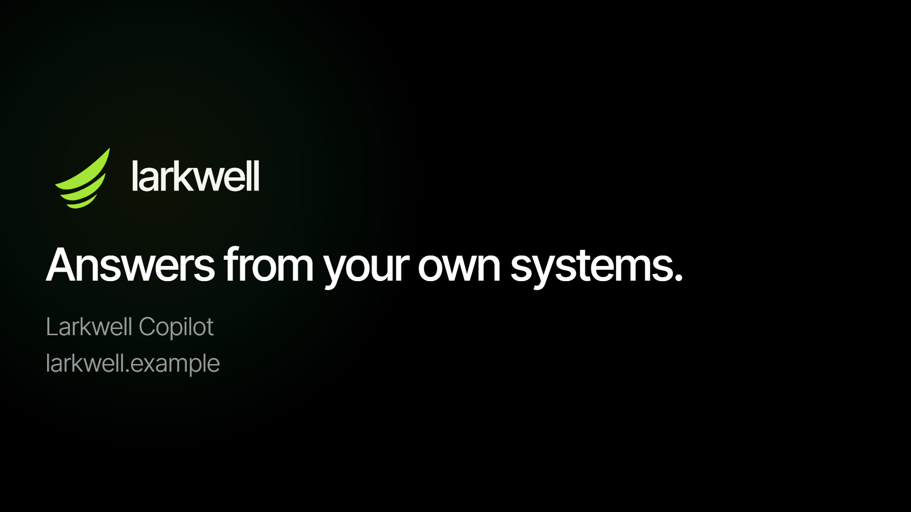
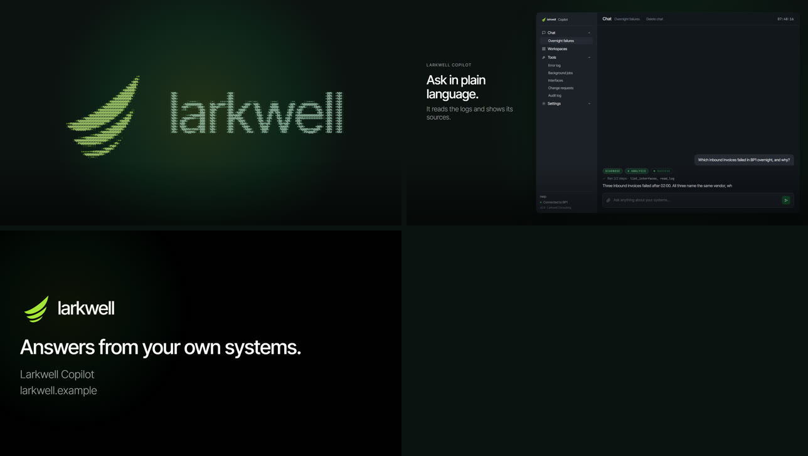
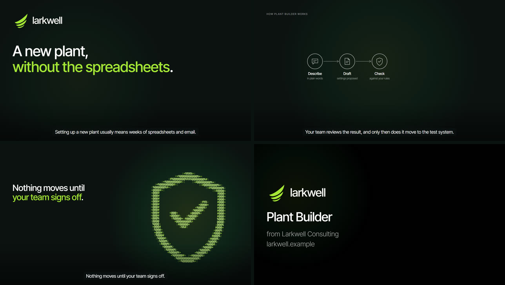
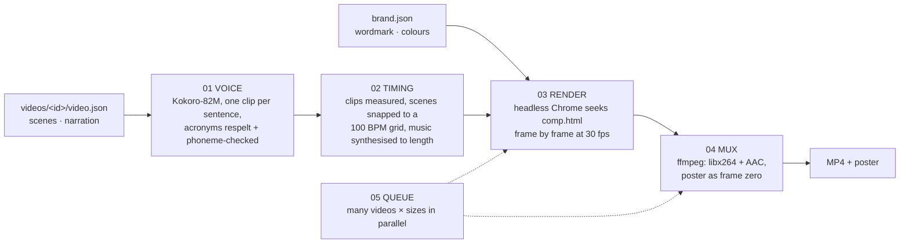
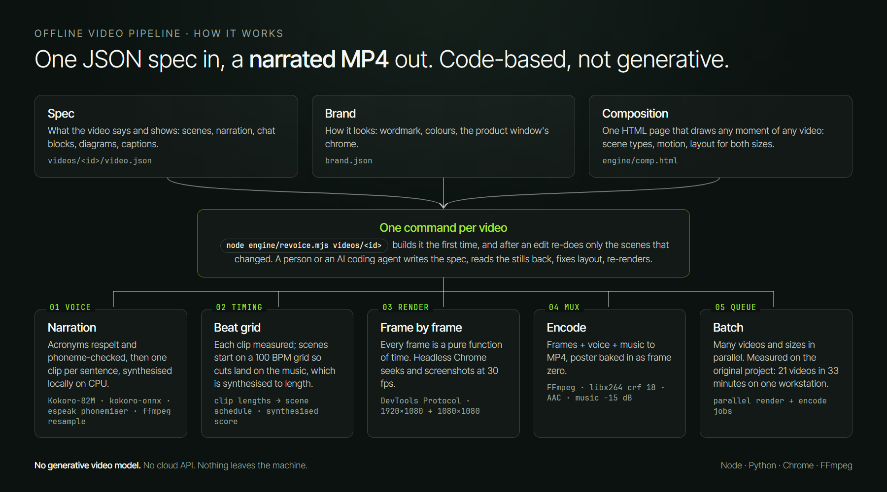

# offline-video-pipeline

**One JSON spec in, a narrated 1920×1080 (and 1080×1080) MP4 out. Fully offline: no cloud API, no generative video model.**

[](docs/samples/copilot-teaser-1920x1080.mp4)

*The sample above (click for the MP4) was rendered by this repo from [`videos/copilot-teaser/video.json`](videos/copilot-teaser/video.json).*

The pipeline reads a short spec per video (scenes, narration, on-screen text, chat exchanges, diagrams), speaks the narration with a local text-to-speech model, lays the scenes on a musical beat grid, draws every frame with one HTML page in headless Chrome, and encodes the result with ffmpeg. Change one sentence and it re-voices and re-renders only that scene.

> **Sanitised template.** This is a cleaned-up version of a video engine I built at work. The company, product names, brand, systems, people and every number in the samples ("Larkwell Consulting", "Larkwell Copilot", "Plant Builder", `BP1`, …) are invented. No code, text or media from the original project's videos is included.

## Result

Measured on the original project: **21 videos rendered in 33 minutes on one workstation, with no cloud APIs.** Each video came out in two sizes from one spec, with narration, music and a poster frame.

Measured on this template, on one workstation with 28 logical cores (Windows + WSL):

| Step | Time |
|---|---|
| Voice + timing + music, per sample video | about 15 s |
| Both samples, both sizes (4 MP4s, 56 s of video each size), rendered and encoded in parallel | 5.0 min |
| Change one scene's narration and rebuild: only that scene re-voiced and re-rendered | 1.1 min (2.9 min for the whole 23 s video) |

| Teaser, one still per scene | Explainer, one still per scene |
|---|---|
|  |  |

## How it works





The diagram's source is [`docs/pipeline.html`](docs/pipeline.html).

| Stage | Files | What happens |
|---|---|---|
| 01 Voice | `engine/vo-directed.py`, `vo-prep.py`, `phon-check.py`, `phon-lines.py`, `lexicon.json` | Each sentence is synthesised separately with [Kokoro-82M](https://huggingface.co/hexgrad/Kokoro-82M) (`af_heart` voice, CPU), then joined with directed pauses: a beat after a full stop, longer after a question, a pause and a slower read before a scene's key line. Acronyms are respelt (`OData` → "oh-data", `BTP` → "B T P") and every sentence is phonemised first to catch bad readings. A hash per scene records what each clip was made from. |
| 02 Timing | `engine/timing.mjs`, `schedule.js`, `synth-upbeat.mjs` | Clip lengths decide scene lengths, rounded up to whole beats of a 100 BPM grid so cuts land on the music. Chat scenes get at least the time their typing and streaming needs (`schedule.js` is shared with the browser so both agree). The music (pad, bass, drums, arpeggio) is synthesised in plain Node to the exact length. |
| 03 Render | `engine/render.mjs`, `comp.html` | `comp.html` draws any moment of any video: `window.seek(t)` renders time `t`, so frames are pure functions of time and can be rendered in any order. `render.mjs` drives headless Chrome over the DevTools protocol (no Puppeteer) and screenshots 30 frames per second. |
| 04 Mux | `engine/mux.sh` | ffmpeg mixes voice and music (music at −15 dB, limiter), encodes H.264 (CRF 18) + AAC, and writes a poster JPEG. The poster is also frame zero, so feeds that show the first frame show the end card. |
| 05 Queue | `engine/queue.mjs` | Renders every (video, size) pair in parallel child processes and muxes each as soon as its frames are done. |

Extras: `engine/revoice.mjs` (the one command that builds or re-builds a video, see below), `engine/contact-sheet.mjs` (one still per scene, tiled, for layout checks), `engine/make-shorts.py` (turns a list of questions into a series of 20-second specs, see `shorts/questions.json`).

## Requirements

| Tool | Used by | Notes |
|---|---|---|
| Node.js 22+ | timing, render, queue | No npm packages; uses the built-in `fetch` and `WebSocket`. |
| Chrome, Chromium or Edge | render | Found automatically in the usual install places or on `PATH`. |
| Python 3.10+ with `kokoro-onnx` | voice | In a venv; see `requirements.txt`. The phonemiser (espeak-ng) comes with it. |
| Kokoro model files | voice | `kokoro-v1.0.onnx` and `voices-v1.0.bin` (about 340 MB together), not in this repo. |
| ffmpeg | voice (resample), mux, contact sheets | Any recent build with libx264. |
| bash + python3 | mux | Present on Linux, macOS and WSL. |

**Windows:** Node and Chrome run on Windows; the voice and mux stages run inside WSL (Ubuntu), which is where the Kokoro venv and ffmpeg live. The scripts call `wsl` for you. **Linux and macOS:** everything runs natively.

### Install the voice model (Linux, macOS or WSL)

```bash
mkdir -p ~/kokoro && cd ~/kokoro && python3 -m venv .venv
```

```bash
~/kokoro/.venv/bin/pip install -r /path/to/offline-video-pipeline/requirements.txt
```

```bash
cd ~/kokoro && curl -LO https://github.com/thewh1teagle/kokoro-onnx/releases/download/model-files-v1.0/kokoro-v1.0.onnx && curl -LO https://github.com/thewh1teagle/kokoro-onnx/releases/download/model-files-v1.0/voices-v1.0.bin
```

Install ffmpeg in the same environment (`sudo apt install ffmpeg`, or `brew install ffmpeg`).

### Configuration

Nothing is hard-coded to one machine. `engine/config.mjs` resolves each setting from an environment variable, then `pipeline.config.json` at the repo root (copy [`pipeline.config.example.json`](pipeline.config.example.json); the real file is git-ignored), then a default:

| Setting | Env var | Default |
|---|---|---|
| `chrome` | `CHROME_PATH` | first Chrome / Chromium / Edge found |
| `shell` | `PIPELINE_SHELL` | `wsl` on Windows, `bash` elsewhere |
| `kokoroDir` | `KOKORO_DIR` | `~/kokoro` (model files + `.venv`), as seen by that shell |
| `kokoroVenv` | `KOKORO_VENV` | `<kokoroDir>/.venv` |
| `ffmpeg` | `FFMPEG` | `ffmpeg` on `PATH` (`~/.local/bin` is added to `PATH`) |
| `prefix` | `OUTPUT_PREFIX` | `larkwell` (output names: `<prefix>-<id>-<size>.mp4`) |
| `voice` | `KOKORO_VOICE` | `af_heart` |

Check what was found:

```bash
node engine/config.mjs
```

Each render uses a fresh, throwaway Chrome profile under the git-ignored `work/` folder and deletes it afterwards.

## Quick start

```bash
git clone https://github.com/TacitDev1/offline-video-pipeline && cd offline-video-pipeline
```

```bash
node engine/revoice.mjs videos/copilot-teaser
```

That runs all five stages and writes `out/larkwell-copilot-teaser-1920x1080.mp4`, the 1080×1080 version and a poster for each. Add `--formats landscape` for one size only. To build several videos at once after voicing them, use the queue:

```bash
node engine/queue.mjs videos/copilot-teaser videos/plant-builder-explainer --jobs 4
```

Check the layout without rendering every frame (needs the voice and timing stages, e.g. `revoice.mjs … --no-render`):

```bash
node engine/contact-sheet.mjs videos/plant-builder-explainer --format square
```

## How a spec is structured

A spec is `videos/<id>/video.json`. Everything the pipeline generates (`vo/`, `vo.wav`, `music.wav`, `timing.json`, `frames-*/`) lands next to it and is git-ignored.

```jsonc
{
  "id": "copilot-teaser",
  "captions": false,                 // burn in captions timed to each spoken sentence
  "voice": { "speed": 0.9,           // base speed: lower is slower; 0.9 is a calm narrator pace
             "pronounce": { "BRW": "B R W" },   // respellings for this video
             "gaps": { "stop": 0.45, "question": 0.85, "key": 1.0 } },
  "brand": { },                      // optional overrides of brand.json for this video
  "scenes": [
    { "id": "s1", "type": "open", "vo": "It's month-end, and the interface queue is red." },
    { "id": "s2", "type": "chat", "cap": "Ask in plain language.", "blocks": [
        { "type": "user", "text": "Which inbound invoices failed in BP1 overnight, and why?" },
        { "type": "ai", "lead": "Three inbound invoices failed after 02:00…", "cols": ["Message", "…"], "rows": [["…"]] } ],
      "vo": "Ask Larkwell Copilot what failed…" },
    { "id": "s3", "type": "end", "h1": "Answers from your own systems.", "vo": "Larkwell Copilot. Answers from your own systems." }
  ]
}
```

Every scene has an `id`, a `type` and usually `vo` (its narration). Timing fields work on any scene: `lead` (silence before the voice), `tail` (after it), `min` (shortest length, seconds), `key` (sentences to land slowly), `speed`, `pace`, `pronounce`.

| Type | Shows | Main fields |
|---|---|---|
| `open` | The logo decoding out of ASCII noise; carries into the corner if a `headline` follows | — |
| `headline` | A large statement; `**text**` is set in the accent colour | `h1`, `lines[]`, `sub`, `at[]`, `subAt` |
| `chain` | Icons joined by arrows, drawn in time with the narration | `nodes[{icon,label,sub,eyebrow,gold}]`, `at[]`, `caps` |
| `arch` | You → product in your own account → your system, with a guard and an audit record | `box`, `platform`, `system`, `guard`, `ledger[[time,user,tool]]` |
| `silos`, `contrast`, `origin` | Story diagrams: a question between four teams; before/after rows; one person's areas feeding a tool | `teams`, `rows`, `areas`, … |
| `chat` | A product window with a typed question and a streamed answer (bullets, checks, tables, code, approval cards); consecutive chat scenes share one window | `blocks[]`, `layout: "full"`, `cap`, `sub`, `session`, `clock` |
| `shot` | A screenshot (an image next to `video.json`) with camera moves and highlight boxes | `img`, `cam[[frac,x,y,w]]`, `hl[[frac,x,y,w,h]]` |
| `fact` | One line with an ASCII icon or a typed JSON record | `h1`, `visual: {kind: "ascii", piece} \| {kind: "audit", fields}` |
| `form`, `terminal` | A form being filled in; a terminal session | `fields[]`; `lines[{kind,text}]` |
| `end` | Logo, line, sub-line, URL | `h1`, `sub`, `url`, `quick` |

Icons for `chain` and ASCII pieces are drawn from line-icon paths in `comp.html` (`chat`, `file`, `shield`, `key`, `lock`, `user`, `db`, `transport`, `check`, …). The brand (wordmark, wing mark, colours, the product window's labels) comes from [`brand.json`](brand.json); the logo is drawn from SVG paths and text at render time, so there is no image file to replace.

## Partial re-rendering

`engine/revoice.mjs` is the one command for building and changing a video:

1. **Voice.** Each scene's narration plan (sentences, speeds, pauses, respellings, voice) is hashed. Only scenes whose hash changed are synthesised again; the last line printed is `CHANGED: s4,s7`.
2. **Resample** the changed clips to 48 kHz.
3. **Timing.** If the new clips still fit inside the old scene times (and do not leave more than 3 s of silence), the times are kept (`timing.mjs --keep`). Otherwise the whole video is re-timed and the music re-made to the new length. (An end card is usually longer than its narration, so a change there tends to re-time; `--retime` forces it.)
4. **Frames.** With kept times, only the changed scenes' frame ranges are rendered again (`render.mjs --range a,b`) into the existing frame folders. After a re-time, the whole video is rendered.
5. **Mux** again. The previous MP4s are copied to `out/before/` so you can compare.

```bash
node engine/revoice.mjs videos/copilot-teaser --only s2
```

Pick a pronunciation or a speed by ear first: `revoice.mjs takes "<sentence>" <word> <alt1> <alt2>` and `revoice.mjs speeds videos/<id> s2 0.85 0.9 0.95` write numbered takes ("Take one … Take two …") to `takes/`.

## Repository layout

```
brand.json                 the invented brand (wordmark, wing mark, colours, product window labels)
engine/                    the pipeline (see the table above) + config.mjs
assets/fonts/              Inter Tight and JetBrains Mono (SIL OFL 1.1)
videos/<id>/video.json     the two sample specs
shorts/questions.json      sample input for make-shorts.py
docs/pipeline.html         the pipeline diagram
docs/samples/              a rendered MP4, its poster and contact sheets
scripts/leak-scan.mjs      fails CI if names, hosts, addresses or keys from a private denylist appear
```

## Licence

MIT, see [LICENSE](LICENSE). The fonts (SIL OFL 1.1), the Kokoro-82M model (Apache 2.0, downloaded separately), kokoro-onnx (MIT), espeak-ng (GPL-3.0) and ffmpeg keep their own licences.
